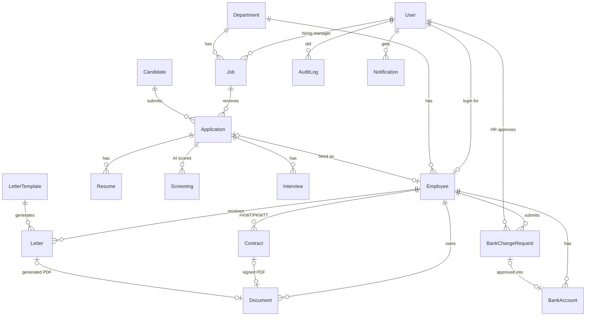

# HR App — Database Schema

Source: [prisma/schema.prisma](prisma/schema.prisma) · MariaDB / MySQL (XAMPP) · 18 tables, lowercase table names (e.g. `audit_log`)

## Diagram

## Main flows

**Hiring → employee**
`Candidate` applies to a `Job` and creates an `Application`. A `Resume` is uploaded, then a `Screening` (AI score and reasons) is saved. HR reviews it and sets `decision`; the AI never rejects anyone on its own. Next come `Interview`s, then stage `HIRED`, which creates an `Employee` linked to the application.

**Bank data change (maker–checker)**
1. The employee fills in a `BankChangeRequest` (status `DRAFT`).
2. They confirm with an OTP, which sets `otpVerifiedAt`, and the status becomes `PENDING_APPROVAL`.
3. The app calls the bank inquiry API (Xendit / Flip) and saves `inquiryName` and `nameMatches`.
4. A notification goes to the employee's email, so they know a change was requested.
5. HR approves (`reviewedById` ≠ the employee's own user). A new `BankAccount` is created, the old one is deactivated, and the change takes effect from `effectivePayroll`.
6. Every step writes to `AuditLog`.

## Sensitive data (UU PDP)

| Data | Where | Protection | Who can see |
|---|---|---|---|
| NIK KTP, NPWP, BPJS numbers | `Employee.*Enc` | Encrypted, UI shows only last 4 | HR, Admin |
| Bank account number | `BankAccount`, `BankChangeRequest` | Encrypted, last 4 shown | HR, Admin, the employee (masked) |
| Base salary | `Contract.baseSalaryEnc` | Encrypted | HR, Admin |
| KTP / KK / NPWP scans | `Document` with `isSensitive = true` | Private bucket, short-lived signed URLs | HR, Admin |
| Candidate CVs | `Resume` | Private bucket | HR, the job's hiring manager |
| Religion, marital status, age, photo from CVs | — | **Removed before AI scoring**, not stored in `parsedData` | — |

Viewing a decrypted value writes an `AuditLog` entry (e.g. `employee.nik_viewed`).

## Access by role

| | Admin | HR | Hiring Manager | Employee |
|---|---|---|---|---|
| Jobs & applications | all | all | own jobs only | — |
| AI screening results | ✓ | ✓ | own jobs only | — |
| Employee records | ✓ | ✓ | own team (non-sensitive) | own profile |
| Contracts & letters | ✓ | ✓ | — | own |
| Bank change | approve | approve | — | submit own |
| Audit log | ✓ | read | — | — |

## Retention

- **Rejected candidates:** `retainUntil` = 6 months after the last activity, or 2 years if `talentPoolConsent` is given. A daily job then anonymises them: personal fields are wiped, CV files deleted, and `anonymizedAt` is set.
- **Employees:** records are kept as long as the law requires after they leave (to be confirmed with legal/accounting). After that, sensitive documents are deleted.
- **Audit log:** append-only. The app's database user has no UPDATE/DELETE rights on this table.

## Rules enforced in the app (not the database)

- Only one active `BankAccount` per employee (enforced in the app and by a database trigger, see the baseline migration).
- A bank request can't be approved by the employee who submitted it.
- A `PKWT` contract must have an `endDate`. A reminder goes out 30 days before it ends (`reminderSentAt`).
- SP1–SP3 letters require a `reason`, and `validUntil` defaults to 6 months.
- `letterNumber` follows the company's numbering format (to be confirmed by HR).

## Questions for HR to confirm

1. What format do you use for letter numbers (nomor surat)?
2. Should we store religion for any HR purpose (e.g. THR timing)? It's currently left out.
3. Do you need family members/dependents as a separate table, or is the `PtkpStatus` field enough for now?
4. Will payroll run in this app later, or only export bank data to an existing payroll system?
